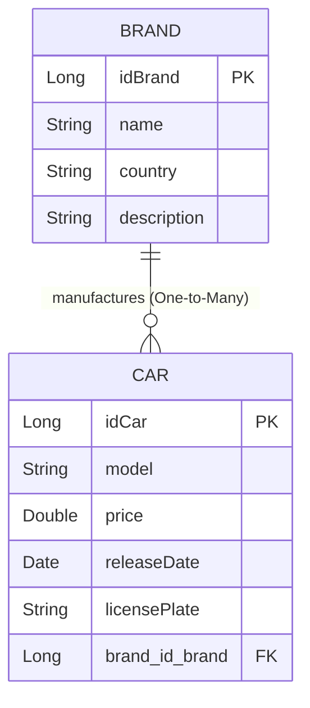

# CarHub — Mini Projet Fullstack
### Architecture : Spring Boot 3 + Angular 20 + Tailwind CSS + MySQL Docker + JWT

Ce projet a été développé dans le cadre du cours **"Développez Full Stack avec Spring Boot 3 et Angular" (Sections 2 à 23)**.

---

## 1. Respect des Spécifications et Consignes

| Consigne de l'Enseignant | Réalisation dans ce Projet |
| :--- | :--- |
| **Deux entités associées en One-To-Many** | `Brand` (1) ───< (N) `Car` |
| **Attributs de types variés** | `Long` (`idCar`, `idBrand`), `String` (`model`, `licensePlate`, `name`, `country`), `Double` (`price`), `Date` (`releaseDate`) |
| **Noms d'attributs distincts du cours** | `idCar`, `model`, `price`, `releaseDate`, `licensePlate` (au lieu de `nomProduit`, `prixProduit`, `dateCreation`) |
| **Variables métier dédiées** | `cars` (et non `prods`), `brands` (et non `cats`) |
| **Nom du projet Spring Boot** | `cars_proj` |
| **Style UI** | Tailwind CSS avec design moderne, responsive et élégant |
| **Base de Données** | MySQL 8.4 conteneurisé avec Docker Compose (`cars_db` et `users_db`) |

---

## 2. Modèle de Données & Relations



---

## 3. Structure du Répertoire Monorepo

```text
SOA/
├── docker-compose.yml          # MySQL 8.4 + phpMyAdmin
├── cars_proj/                  # API des voitures et des marques (port 8082, base cars_db)
│   └── src/main/java/com/example/cars/
│       ├── entities/           # Car, Brand
│       ├── repos/              # CarRepository, BrandRepository (publié en Spring Data REST sur /brand)
│       ├── service/            # CarService, CarServiceImpl
│       ├── restcontrollers/    # CarRESTController
│       ├── config/             # RestConfig (Spring Data REST)
│       └── security/           # SecurityConfig, JWTAuthorizationFilter : vérifie les tokens
├── users_proj/                 # Service des utilisateurs (port 8081, base users_db)
│   └── src/main/java/com/example/users/
│       ├── entities/           # User, Role, VerificationToken
│       ├── service/            # UserServiceImpl (inscription, vérification), EmailService
│       ├── exceptions/         # Erreurs d'inscription, renvoyées en JSON
│       └── security/           # JWTAuthenticationFilter : crée les tokens sur /login
└── cars-frontend/              # Frontend Angular 20 (port 4200)
    └── src/app/
        ├── cars/, add-car/, update-car/      # Parc automobile (CRUD)
        ├── search-by-brand/, search-by-model/ # Recherche : serveur, keyup et pipe
        ├── list-brands/, update-brand/        # Marques : parent et enfant (@Input, @Output)
        ├── login/, register/, verify-email/   # Connexion et inscription
        ├── guards/                            # authGuard (connecté), carGuard (ADMIN)
        ├── interceptors/                      # Ajoute le token à chaque requête
        └── services/                          # CarService, AuthService
```

---

## 4. Endpoints API REST

### API des voitures (`http://localhost:8082`)

Chaque requête doit envoyer `Authorization: Bearer <token>`.

| Méthode | Endpoint | Rôle requis | Description |
| :--- | :--- | :--- | :--- |
| `GET` | `/api/all` | ADMIN, USER | Liste des voitures avec leur marque |
| `GET` | `/api/{id}` | ADMIN, USER | Détails d'une voiture |
| `POST` | `/api` | ADMIN | Ajouter une voiture |
| `PUT` | `/api` | ADMIN | Modifier une voiture |
| `DELETE` | `/api/{id}` | ADMIN | Supprimer une voiture |
| `GET` | `/api/carsbrand/{idBrand}` | ADMIN, USER | Voitures d'une marque |
| `GET` | `/api/carsbymodel/{model}` | ADMIN, USER | Recherche par mot-clé du modèle |
| `GET` | `/api/brands`, `/api/brands/{id}` | ADMIN, USER | Marques (JSON simple) |
| `GET` | `/brand`, `/brand/{id}` | ADMIN, USER | Marques avec Spring Data REST (format HAL) |
| `POST`, `PUT`, `DELETE` | `/brand`, `/brand/{id}` | ADMIN | Gérer les marques |

### Service des utilisateurs (`http://localhost:8081`)

| Méthode | Endpoint | Rôle requis | Description |
| :--- | :--- | :--- | :--- |
| `POST` | `/login` | Public | Renvoie le token dans l'en-tête `Authorization` |
| `POST` | `/register` | Public | Crée un compte désactivé et envoie un code par email |
| `GET` | `/verifyEmail/{code}` | Public | Active le compte (le code expire après 15 minutes) |
| `GET` | `/all` | ADMIN | Liste des utilisateurs |

**401** : pas de token, ou token invalide. **403** : token valide, mais le rôle n'est pas autorisé.

---

## 5. Instructions d'Exécution

### Étape 1 : Démarrer la Base de Données avec Docker
Dans le dossier racine `SOA` :
```bash
docker compose up -d
```
- **MySQL** : `localhost:3306` (Utilisateur : `root`, sans mot de passe). Les bases `cars_db` et `users_db` sont créées automatiquement.
- **phpMyAdmin** : `http://localhost:8080`

### Étape 2 : Démarrer les deux services Spring Boot
Dans deux terminaux, l'un dans `users_proj` et l'autre dans `cars_proj` :
```bash
# Windows
.\mvnw.cmd spring-boot:run

# Linux / Mac
sh mvnw spring-boot:run
```
- **Service des utilisateurs** : `http://localhost:8081`
- **API des voitures** : `http://localhost:8082`

### Étape 3 : Démarrer le Frontend Angular
Dans le dossier `cars-frontend` :
```bash
npm install
npm start
```
L'application web est accessible sur : **`http://localhost:4200`**

### Comptes de démonstration

| Utilisateur | Mot de passe | Rôles |
| :--- | :--- | :--- |
| `admin` | `admin123` | ADMIN, USER |
| `yasser` | `yasser123` | USER |

Ces comptes servent uniquement au développement local.

### Fichier `.env` (facultatif)

Copiez `.env.example` vers `.env` à la racine, puis remplissez-le. Git ignore ce fichier, et les deux services le lisent au démarrage. Redémarrez-les après chaque modification.

| Variable | Rôle | Sans cette variable |
| :--- | :--- | :--- |
| `JWT_SECRET` | Clé de signature, identique dans les deux services | Clé de développement publique |
| `MAIL_USERNAME`, `MAIL_PASSWORD` | Compte SMTP (mot de passe d'application Gmail) | Le code de vérification s'affiche dans la console de `users_proj` |

### Exécuter les tests
MySQL doit être démarré. Dans `users_proj` ou `cars_proj` :
```bash
.\mvnw.cmd test
```

---

## 6. Le token JWT

Un JWT (JSON Web Token) est une chaîne signée qui prouve qui est l'utilisateur et quels sont ses rôles. Le serveur n'a donc pas besoin de garder une session.

**Structure** : trois parties en Base64URL séparées par des points, `header.payload.signature`.

| Partie | Contenu | Exemple |
| :--- | :--- | :--- |
| Header | Algorithme de signature et type | `{"alg":"HS256","typ":"JWT"}` |
| Payload | Données : `sub` (utilisateur), `roles`, `exp` (expiration) | `{"sub":"admin","roles":["ADMIN"],"exp":1730000000}` |
| Signature | HMAC du header et du payload avec la clé secrète | Prouve que le token n'a pas été modifié |

Le payload est **encodé, pas chiffré** : tout le monde peut le lire, donc il ne contient jamais de mot de passe. La signature empêche de le modifier.

**Fonctionnement** :

1. L'utilisateur envoie son nom et son mot de passe à `/login`.
2. Le serveur les vérifie, crée un JWT signé et le renvoie dans l'en-tête `Authorization`.
3. Le client garde le token (dans `localStorage` pour Angular).
4. À chaque requête, le client envoie `Authorization: Bearer <token>`.
5. Le serveur vérifie la signature et l'expiration, lit les rôles, puis accepte ou refuse (401 / 403).

**Session ou JWT** : une session est stockée sur le serveur (stateful), ce qui complique le passage à plusieurs serveurs. Un JWT est porté par le client et vérifié avec la clé (stateless), ce qui convient aux microservices et aux SPA.
